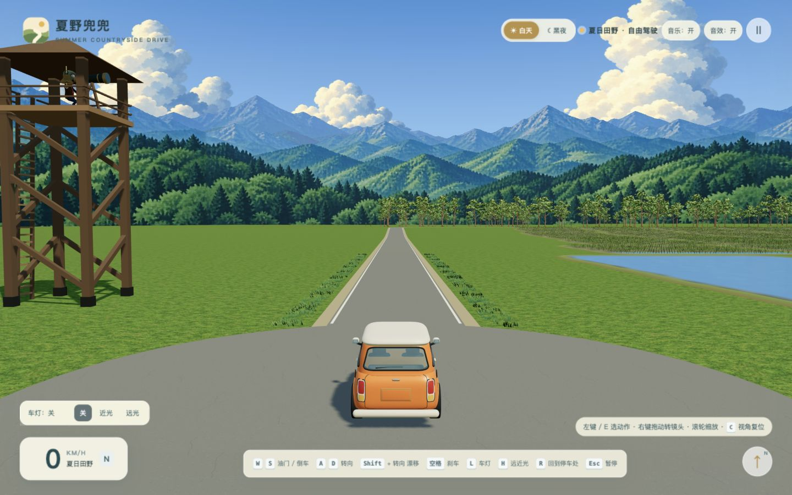
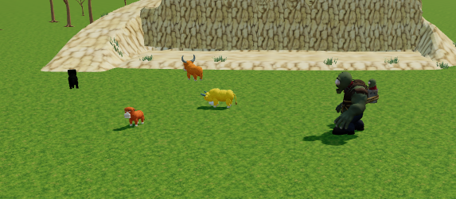
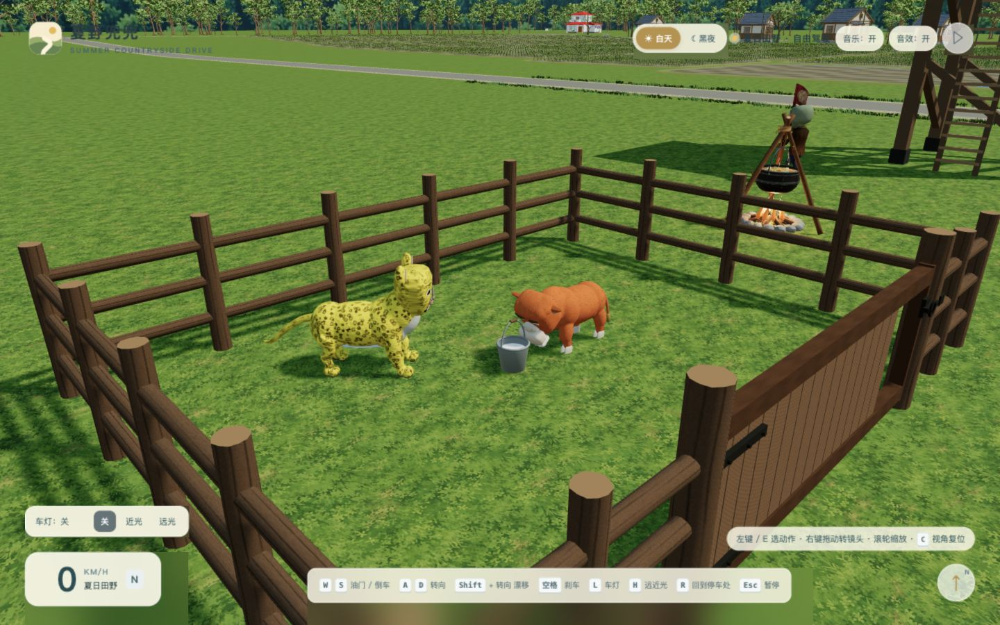
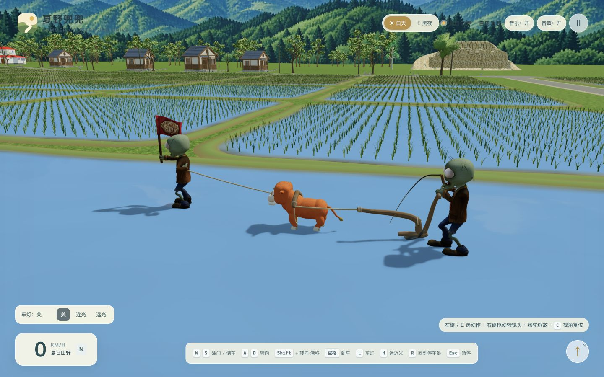

#  Summer Roam · 夏野兜兜

[简体中文](README.md) | [English](README.en.md)

开着橙色小车，在夏日田野里慢慢兜一圈。

一款使用 Three.js 制作的 3D 自由驾驶与探索游戏。沿乡间道路欣赏水渠、树林和住宅，和动物打个招呼，看看牛群与僵尸营地之间会发生什么。

**[在线游玩](https://game.biubiubiu.win)** · 推荐使用电脑浏览器、键盘和鼠标



## 田野里的伙伴

停好车，左键点击动物，或将鼠标指向动物后按 **E**，再从动作圈选择互动。牛群、狼和豹都能拍一拍或触摸、叫一声、吃草或嗅地、转身，以及夜间休息。

| 伙伴 | 可以体验什么 |
| --- | --- |
| 母牛 | 回应小牛的呼唤，靠近碰鼻安慰；狼追咬小牛后，还可能追狼保护孩子 |
| 公牛 | 多拍几下会生气：第 2 次警告，第 3 次起停车互动可触发顶车；也会保护牛群、冲撞靠近的巨人僵尸 |
| 小牛 | 从第 4 次拍击起可触发找妈妈；落单时可能被抓回营地，开门后可能逃跑回家 |
| 狼 | 触摸后可能跑上山，也可能追咬小牛，引来母牛追赶；动作圈可选择登山、下山 |
| 豹 | 选择上树、下树，观察爬树和枝上休息；小牛关入围栏后，还可以让它叼桶送奶 |
| 小白 | 在野原家四周慢走、短跑、摇尾、坐下和伸懒腰 |
| 金鱼 | 在水渠中缓慢游动、摆尾和转向，俯视更容易看清 |

## 营地里的小故事

- **抓牛与逃跑**：选中抓牛车，使用“出车抓牛”，观察巨人僵尸抱牛装车、运回营地。打开围栏门后，小牛可能逃跑，引来报警、追回和公牛救援；也可选中巨人僵尸手动抱牛或追回。
- **豹送奶**：小牛入栏关门后，选中豹的“给小牛送奶”（**7**）。它会叼起奶桶，跃过围栏让小牛喝奶，再带空桶返回。
- **水田耕作**：小牛入栏关门后，选中**田边扶犁工**的“开始耕田”。旗手牵牛、扶犁工搬犁，队伍一起下田；可以提前结束，收工后小牛送回围栏。

动物和僵尸有自己的活动节奏，部分事件随机发生。动作暂不可用时，动作圈会说明原因；等当前任务结束后再试。

## 操作

| 操作 | 按键 |
| --- | --- |
| 前进 / 后退、转向 | W / S、A / D，或方向键 |
| 漂移 / 刹车 | Shift + 转向 / 空格 |
| 选择对象、展开动作圈 | 左键点击，或鼠标指向对象后按 E |
| 执行动作 / 关闭动作圈 | 点击按钮或按对应数字键 / E 或 Esc |
| 旋转 / 缩放镜头 | 右键拖动 / 滚轮 |
| 恢复车尾视角 / 小车回到起点 | C / R |
| 暂停 / 继续 | 动作圈关闭时按 Esc |
| 开关车灯 / 切换远近光 | L / H（先打开车灯） |

点击动物只会选择对象。开启音效并靠近观察，可以更完整地体验动物互动；部分连锁事件依赖叫声完整播放。小车挡住门口、路口或动物落点时，任务可能等待，挪开后可继续。

<details>
<summary>更多游戏截图</summary>

**田野动物**



**豹送奶**



**水田耕作**



</details>

## 本地运行

需要 Node.js ≥22.13.0。

```sh
npm ci
npm start
```

打开 `http://localhost:5173/`。端口冲突时可运行 `npm start -- --port 5174`。

## 开发

```sh
npm run test:unit   # 快速回归
npm run verify     # 格式、Lint、完整测试、构建及发布校验
npm run build
npm run preview
```

- [开发说明](docs/development.md)
- [部署说明](docs/deployment.md)
- [资源来源与许可](assets-source/ASSETS.md)

## 许可

本项目自有源代码与制作脚本采用 [MIT License](LICENSE)。第三方代码、模型、纹理、音频和参考素材适用各自的许可；项目的 MIT License 不替代这些资源的授权。

资源清单包含非商业许可、Sketchfab Standard 许可以及授权尚未确认的素材。公开分发完整游戏或素材前，需要逐项确认相应授权。模型和音频的原有署名文件保留在 `src/assets/` 中。
